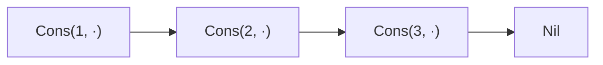
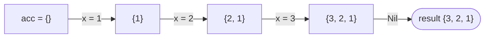
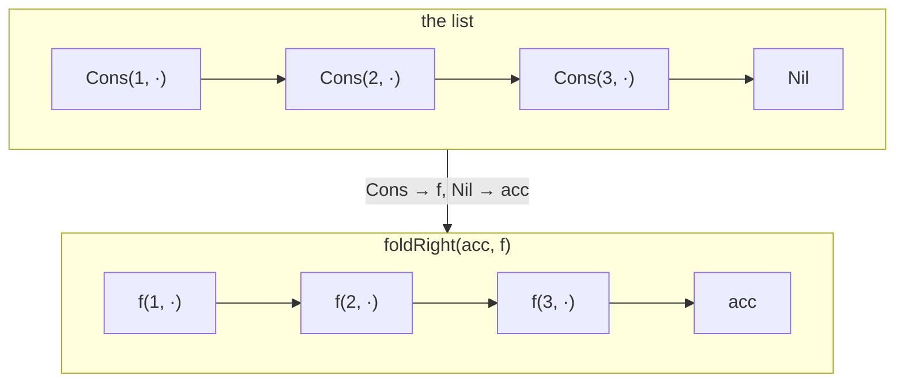
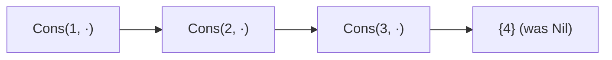

# OCaml-style Cons List in Java

Inspired by [Functional Data Structures and Pattern Matching in Scala](https://medium.com/codex/functional-data-structures-and-pattern-matching-in-scala-7a379092e1e4)

The `Main.java` files shows basic usage of the cons list implementation using Java 27.

The project is split into two modules: `cons.list` (the library) and `app` (the demo).

## Compiling

```bash
rm -rf out
javac --release 27 -d out --module-source-path . $(find cons.list app -name "*.java")
```

`--module-source-path .` compiles both modules in one pass, in dependency order, into `out/<module>/`.

Each module is written as an *exploded module* (a plain directory of `.class` files, not a jar):

```
out/
├── cons.list/
│   ├── module-info.class
│   └── cons/list/Cons.class, GenericList.class, Nil.class
└── app/
    ├── module-info.class
    └── app/Main.class
```

`java --module-path out` accepts these directories just like modular jars.

## Running

```bash
java --module-path out -m app/app.Main
```

or 

```bash
./run.sh
```

`run.sh` does the whole cycle:

1. Checks that both `java` and `javac` are version 27, otherwise prints an error and stops.
2. Deletes `out/` and compiles both modules into it (see [Compiling](#compiling)).
3. Runs `app/app.Main` from the module path.

## What the demo shows

`Main.java` prints:

```
Original    = {1, 2, 3, 4, 5, 6, 7, 8, 9, 10, 11, 12, 13, 14, 15}
Somme       = 120
Reverse     = {15, 14, 13, 12, 11, 10, 9, 8, 7, 6, 5, 4, 3, 2, 1}
Append 11   = {1, 2, 3, 4, 5, 6, 7, 8, 9, 10, 11, 12, 13, 14, 15, 11}
Filter odd  = {7, 9, 11, 13, 15}
Quick sort  = {1, 2, 3, 4, 5, 6, 7, 8, 9, 10, 11, 12, 13, 14, 15}
Quick sort  = {1, 2, 3, 4, 5, 6, 7, 8, 9}
Graphemes   = {🔠,  , L, ', a, b, s, u, r, d, e, ,,  , c, ', e, s, t, ...,  , 🚀}
Left iter   = (((0 + 1) + 2) + 3)
Left rec    = (((0 + 1) + 2) + 3)
Right iter  = (1 + (2 + (3 + 0)))
Right rec   = (1 + (2 + (3 + 0)))
Big iter    = 500000500000
Big rec     = StackOverflowError
```

Line by line:

- **Original**: builds the list by consing `15`, `14`, … `1` onto `GenericList.empty()`, like `1 :: 2 :: … :: []` in OCaml.
- **Somme**: sums the elements with `foldLeft(0, Integer::sum)`.
- **Reverse**: `rev()`, itself a `foldLeft` that conses each element onto a new list.
- **Append 11**: `append(GenericList.of(11))` joins two lists, like OCaml's `@`.
- **Filter odd**: `filter` keeps the elements matching a predicate, here odd numbers greater than 5. The predicate combines `Main::isOdd` with `greaterThan(5)` using `Predicate.and`; `greaterThan(n)` returns a `Predicate<Integer>`, like a partial application `greater_than 5` in OCaml.
- **Quick sort**: a recursive quicksort written with a pattern-matching `switch`: `case Nil` for the empty list, `case Cons(var pivot, var tail)` to split head from tail, as in OCaml's `match … with [] -> … | pivot :: tail -> …`. It runs on the list above, then on the unsorted `GenericList.of(5, 3, 2, 8, 7, 1, 9, 6, 4)`.
- **Graphemes**: splits a quote from Camus into user-perceived characters with `BreakIterator` (so the emojis stay whole), conses them onto a `GenericList<String>`, which builds it backwards, then `rev()` restores the order.
- **Left / Right, iter / rec**: folds `{1, 2, 3}` with functions that build a string, so the output shows the order in which the elements are combined. The iterative folds (`foldLeft`, `foldRight`) and the recursive ones (`foldLeftRec`, `foldRightRec`) give the same result (see [foldLeft and foldRight](#foldleft-and-foldright)).
- **Big iter / Big rec**: sums a list of 1,000,000 elements. The iterative `foldLeft` works; the recursive `foldLeftRec` runs out of stack, and the demo catches the `StackOverflowError` to print it.

The lists are immutable: every operation returns a new list, so `Reverse`, `Append 11`, `Filter odd` and the first `Quick sort` all start from the same original `{1, …, 15}`.

## foldLeft and foldRight

Every operation of `GenericList` is built on two folds. Both walk the list and combine its elements with a function `f`, starting from an initial value `acc`. They differ in the **direction** in which the results are combined.

Each fold exists in two versions with the same results: a recursive one (`foldLeftRec`, `foldRightRec`), which mirrors OCaml and is used below to explain how the folds work, and an iterative one (`foldLeft`, `foldRight`), which the other operations use (see [Recursive and iterative versions](#recursive-and-iterative-versions)).

The examples below use the list `{1, 2, 3}`, which is three `Cons` cells ending with `Nil`:



### foldLeft: the accumulator travels from left to right

```java
// foldLeftRec
case Nil<T> _ -> acc;
case Cons(var head, var tail) -> tail.foldLeftRec(f.apply(acc, head), f);
```

`foldLeft` applies `f` to the accumulator and the head **first**, then passes the new accumulator on to the tail. When it reaches `Nil`, the accumulator is the result:

```
foldLeft(acc, f) on {1, 2, 3}  =  f(f(f(acc, 1), 2), 3)
```

With `rev()`, which is `foldLeft(empty(), (acc, x) -> new Cons<>(x, acc))`, each element is consed in front of the accumulator, so the list comes out reversed:



The sum `foldLeft(0, Integer::sum)` follows the same path: `((0 + 1) + 2) + 3 = 6`.

### foldRight: replace each Cons with f and Nil with acc

```java
// foldRightRec
case Nil<T> _ -> acc;
case Cons(var head, var tail) -> f.apply(head, tail.foldRightRec(acc, f));
```

`foldRight` first goes down to the end of the list, then combines the elements **on the way back**, starting from the last one:

```
foldRight(acc, f) on {1, 2, 3}  =  f(1, f(2, f(3, acc)))
```

An easy way to picture it: `foldRight` keeps the shape of the list, but replaces every `Cons` with `f` and the final `Nil` with `acc`:



This is why several operations are one line:

- **`append(other)`** is `foldRight(other, Cons::new)`: keep every `Cons`, replace `Nil` with `other`.
- **`filter(pred)`** is `foldRight(empty(), (x, acc) -> pred.test(x) ? new Cons<>(x, acc) : acc)`: keep the `Cons` cells whose element matches, drop the others.

For example, `{1, 2, 3}.append({4})`:



### Which one to use

| | `foldLeft` | `foldRight` |
|---|---|---|
| Combines | from the first element to the last | from the last element to the first |
| Result on `{1, 2, 3}` | `f(f(f(acc, 1), 2), 3)` | `f(1, f(2, f(3, acc)))` |
| Building a list with `Cons` | reverses the order | keeps the order |
| OCaml | `List.fold_left f acc l` | `List.fold_right f l acc` |
| Used by | `rev`, `toString`, the demo's `sum` | `append`, `filter` |

### Recursive and iterative versions

Java does not optimise tail calls: every recursive call adds a frame to the stack, so `foldLeftRec` and `foldRightRec` throw a `StackOverflowError` on very long lists (a list of 1,000,000 elements is enough).

The iterative versions give the same results with a constant stack depth:

```java
default <R> R foldLeft(R acc, BiFunction<R, T, R> f) {
  var current = this;
  while (current instanceof Cons(var head, var tail)) {
    acc = f.apply(acc, head);
    current = tail;
  }
  return acc;
}

default <R> R foldRight(R acc, BiFunction<T, R, R> f) {
  return rev().foldLeft(acc, (r, x) -> f.apply(x, r));
}
```

- **`foldLeft`** is the recursion of `foldLeftRec` turned into a loop: the recursive call was the last thing the method did (a *tail call*), so it can become "move on to the tail and repeat". The record pattern in `while (current instanceof Cons(var head, var tail))` keeps the pattern-matching style.
- **`foldRight`** cannot be turned into a loop directly, because `f` needs the result of the recursive call. Instead, it reverses the list and folds from the left: the elements are combined from the last to the first, which is exactly the `foldRight` order. The cost is one extra list, built by `rev()`.

OCaml makes the same trade-off: `List.fold_left` is tail-recursive, which the OCaml compiler turns into a loop, while `List.fold_right` is not, and can also overflow the stack on very long lists.

### Which version the library uses

`rev`, `append`, `filter` and `toString` use the iterative `foldLeft` and `foldRight`, so they work on lists of any length. The recursive `foldLeftRec` and `foldRightRec` stay public, to show the OCaml-style definition; the end of the demo compares both versions (see [What the demo shows](#what-the-demo-shows)).
